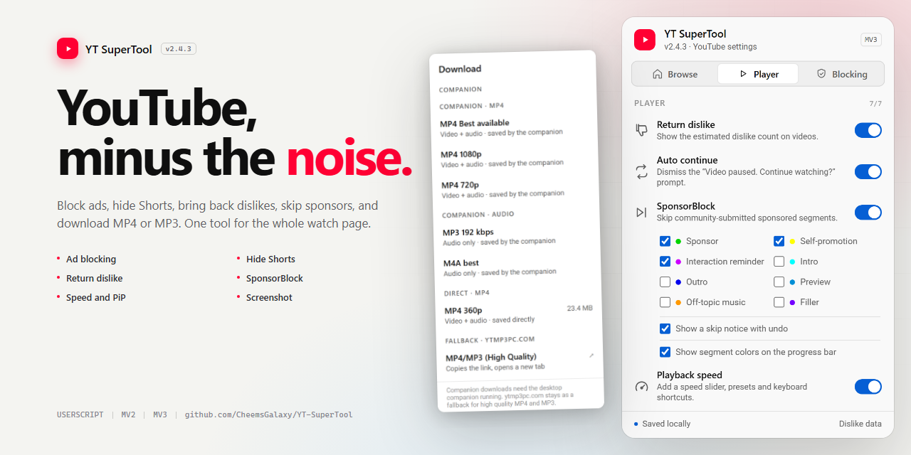
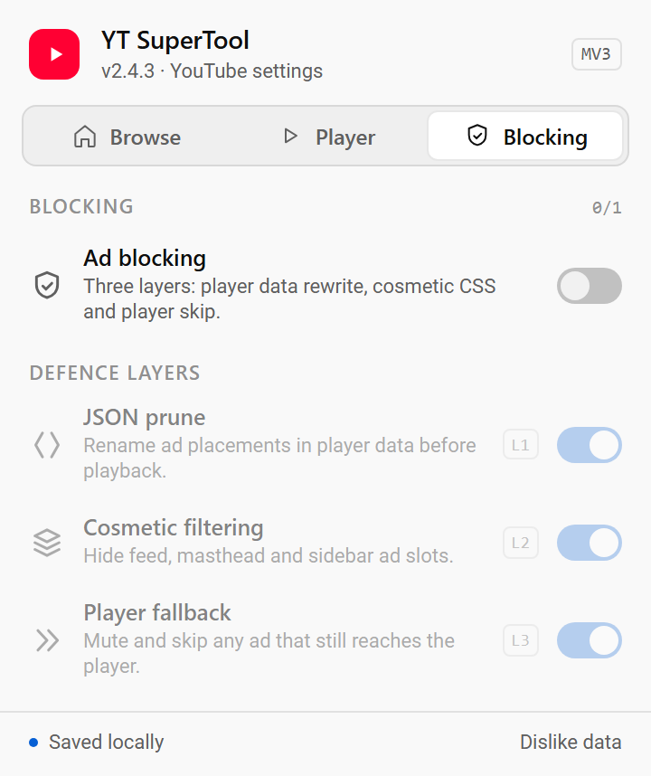
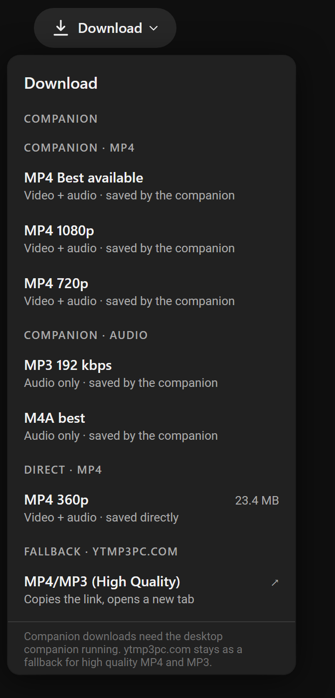
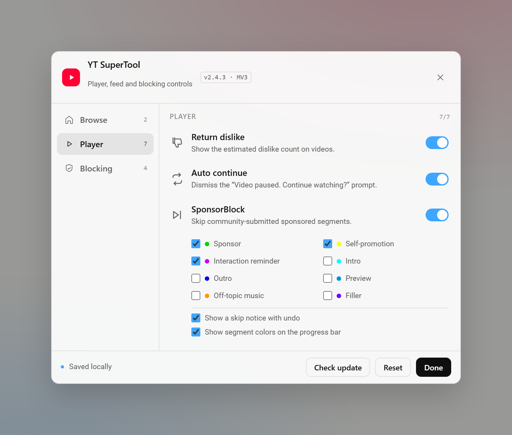

# YT SuperTool

<picture>
  <source media="(prefers-color-scheme: dark)" srcset="promo/banner-dark.png">
  <source media="(prefers-color-scheme: light)" srcset="promo/banner-light.png">
  
</picture>

[Tiếng Việt](#vi) | [English](#en) | [Ủng hộ](#donate)

<a name="vi"></a>
## Tiếng Việt

YT SuperTool thêm vào YouTube bộ điều khiển cho feed, trình phát và quảng cáo. Tool ẩn Shorts, dọn trang chủ, khôi phục số dislike, bỏ qua đoạn SponsorBlock, đổi tốc độ phát, chụp khung hình, mở cửa sổ nổi và tải video. Ba lớp chặn quảng cáo có sẵn nhưng tắt mặc định. Một lõi mã nguồn build ra userscript, extension Manifest V2 và Manifest V3.

[Firefox Add-ons](https://addons.mozilla.org/vi/firefox/addon/yt-supertool/) | [Bản phát hành](https://github.com/CheemsGalaxy/YT-SuperTool/releases) | [Issues](https://github.com/CheemsGalaxy/YT-SuperTool/issues) | [Discord](https://discord.gg/n7JTT7ssNR) | [YouTube](https://www.youtube.com/@cheemsnogy)

Phiên bản hiện tại: 2.4.3

### Tải xuống

| Nền tảng | Gói | Cài đặt |
|---|---|---|
| Firefox 109 trở lên | Mozilla Add-ons | [Thêm vào Firefox](https://addons.mozilla.org/vi/firefox/addon/yt-supertool/) |
| Userscript | `yt-supertool.user.js` | [Cài nhanh](https://raw.githubusercontent.com/CheemsGalaxy/YT-SuperTool/main/dist/userscript/yt-supertool.user.js) |
| Chrome, Edge, Brave, Chromium khác | `yt-supertool-mv3.zip` | [Tải ZIP](https://github.com/CheemsGalaxy/YT-SuperTool/releases/download/Release/yt-supertool-mv3.zip) |
| Firefox 109 trở lên, tự cài | `yt-supertool-mv2.zip` | [Tải ZIP](https://github.com/CheemsGalaxy/YT-SuperTool/releases/download/Release/yt-supertool-mv2.zip) |
| Companion Windows x64 | `yt-supertool-companion-1.0.0-win32-x64.zip` | [Tải ZIP](https://github.com/CheemsGalaxy/YT-SuperTool/releases/download/Release/yt-supertool-companion-1.0.0-win32-x64.zip) · [SHA-256](https://github.com/CheemsGalaxy/YT-SuperTool/releases/download/Release/SHA256SUMS.txt) |

### Cài đặt

#### Firefox

1. Mở [YT SuperTool trên Mozilla Add-ons](https://addons.mozilla.org/vi/firefox/addon/yt-supertool/).
2. Bấm "Thêm vào Firefox" và xác nhận quyền.
3. Mở YouTube. Nút YT SuperTool nằm ở header, popup mở bộ cài đặt.

Bản trên Add-ons hỗ trợ Firefox 109 trở lên và tự cập nhật. Cách này không cần bật chế độ nhà phát triển.

#### Userscript

1. Cài [Tampermonkey](https://www.tampermonkey.net/) hoặc [Violentmonkey](https://violentmonkey.github.io/).
2. Bấm [cài nhanh](https://raw.githubusercontent.com/CheemsGalaxy/YT-SuperTool/main/dist/userscript/yt-supertool.user.js). Trình quản lý userscript mở màn hình cài đặt.
3. Kiểm tra quyền rồi xác nhận.
4. Mở YouTube.

Userscript không chạy trên YouTube Music và Studio. Trình quản lý userscript tự kiểm tra bản mới qua `@updateURL`.

#### Chrome, Edge và Brave

1. Tải [`yt-supertool-mv3.zip`](https://github.com/CheemsGalaxy/YT-SuperTool/releases/download/Release/yt-supertool-mv3.zip).
2. Giải nén vào một thư mục cố định. Trình duyệt đọc extension từ thư mục này, nên đừng xóa sau khi cài.
3. Mở `chrome://extensions`, `edge://extensions` hoặc `brave://extensions`.
4. Bật "Developer mode".
5. Bấm "Load unpacked" và chọn thư mục vừa giải nén.
6. Mở YouTube.

Popup extension có ba tab giống panel. Chrome, Edge và Brave cảnh báo với extension cài ngoài Web Store. Cảnh báo này bình thường khi dùng "Load unpacked".

#### Firefox, cài thủ công

Dùng cách này khi bạn muốn chạy gói MV2 hoặc tự kiểm tra build:

1. Tải [`yt-supertool-mv2.zip`](https://github.com/CheemsGalaxy/YT-SuperTool/releases/download/Release/yt-supertool-mv2.zip).
2. Giải nén vào thư mục cố định.
3. Mở `about:debugging#/runtime/this-firefox`.
4. Bấm "Load Temporary Add-on".
5. Chọn `manifest.json` trong thư mục đã giải nén.

Firefox xóa add-on tạm khi đóng trình duyệt. Cài lâu dài cần gói XPI đã ký. Bản trên Mozilla Add-ons đã được ký.

#### Companion trên Windows (tùy chọn)

Companion là ứng dụng desktop riêng, chỉ cần khi bạn muốn tải MP4/MP3 chất lượng cao bằng yt-dlp và FFmpeg trên máy. Không có companion, extension vẫn tải MP4 progressive trực tiếp và chuyển link sang ytmp3pc.com.

1. Tải [`yt-supertool-companion-1.0.0-win32-x64.zip`](https://github.com/CheemsGalaxy/YT-SuperTool/releases/download/Release/yt-supertool-companion-1.0.0-win32-x64.zip) và file [SHA-256](https://github.com/CheemsGalaxy/YT-SuperTool/releases/download/Release/SHA256SUMS.txt).
2. Đối chiếu hash:

   ```powershell
   Get-FileHash .\yt-supertool-companion-1.0.0-win32-x64.zip -Algorithm SHA256
   ```

3. Giải nén và chạy `Install YT SuperTool Companion.cmd`.
4. Mở YouTube, bấm "Download", nhập mã pair mà installer in ra.

Installer chép chương trình vào `%LOCALAPPDATA%\YT SuperTool Companion`, thêm shortcut khởi động và năm shortcut desktop. Gói dành cho Windows 10 và 11 x64. Hướng dẫn đầy đủ nằm trong [companion/INSTALL_WINDOWS.md](companion/INSTALL_WINDOWS.md).

### Tính năng chính

| Nhóm | Tính năng | Hành vi | Mặc định |
|---|---|---|---|
| Browse | Ẩn Shorts | Xóa kệ Shorts, tab và thẻ trong feed. | Bật |
| Browse | Dọn trang chủ | Ẩn promo, khảo sát, Playables và kệ live. | Bật |
| Player | Khôi phục dislike | Hiện số dislike ước tính từ API Return YouTube Dislike. | Bật |
| Player | SponsorBlock | Bỏ qua đoạn sponsor, self-promotion và nhắc tương tác do cộng đồng gửi; tô màu đoạn trên thanh tiến trình. | Bật |
| Player | Tự động xem tiếp | Đóng hộp thoại "Video paused. Continue watching?". | Bật |
| Player | Tốc độ phát | Thanh tốc độ 0.25x đến 10x, preset và phím `<` / `>`, mỗi lần 0.25x. | Bật |
| Player | Picture in picture | Mở video hiện tại trong cửa sổ nổi. | Bật |
| Player | Chụp màn hình | Lưu khung hình hiện tại thành PNG. | Bật |
| Player | Tải video | MP4 progressive tải trực tiếp, preset companion tùy chọn, fallback ytmp3pc.com. | Bật |
| Blocking | Chặn quảng cáo | Ba lớp: JSON prune, cosmetic filtering và player fallback. | Tắt |

SponsorBlock bỏ qua sponsor, self-promotion và nhắc tương tác mặc định. Panel cũng có Intro, Outro, Preview, Off-topic music và Filler; các mục này tắt sẵn. Thông báo skip có nút Undo, và màu đoạn trên thanh tiến trình có thể tắt trong cài đặt.

#### Chặn quảng cáo

Ba lớp trong trang tắt mặc định. YouTube thay đổi cách phát quảng cáo và cách phát hiện adblock thường xuyên, nên các lớp có sẵn có thể ngừng hoạt động, làm hỏng phát lại hoặc kích hoạt phản hồi chống adblock. Để dùng hàng ngày, cài [uBlock Origin](https://ublockorigin.com/) trên Firefox hoặc [uBlock Origin Lite](https://chromewebstore.google.com/detail/ublock-origin-lite/ddkjiahejlhfcafbddmgiahcphecmpfh) trên Chrome, Edge và Brave. Chỉ bật các lớp có sẵn nếu bạn chấp nhận rủi ro bảo trì này.

Tool không xóa dữ liệu quảng cáo khỏi phản hồi trình phát. Tool đổi tên các khóa `adPlacements`, `playerAds`, `adSlots`, `adBreakHeartbeatParams`, `adParams` và `adSafetyReason` trong JSON, tắt cờ dò adblock của trình phát, rồi gỡ modal cảnh báo nếu nó vẫn hiện. Cách đổi tên khóa ít phụ thuộc nhãn nút và selector quảng cáo hơn quy tắc cosmetic.

1. JSON prune: đổi tên các khóa quảng cáo trong phản hồi trình phát trước khi YouTube đọc. Lớp này chạy trong main world tại `document-start`.
2. Cosmetic filtering: ẩn slot quảng cáo trong feed, masthead, sidebar và trình phát. Quy tắc chỉ áp dụng khi công tắc tổng và lớp cosmetic cùng bật.
3. Player fallback: tắt tiếng quảng cáo lọt vào trình phát, bấm nút bỏ qua và tua đến cuối. Lớp này khôi phục trạng thái tắt tiếng và tốc độ phát trước đó sau quảng cáo.

<picture>
  <source media="(prefers-color-scheme: dark)" srcset="promo/popup-dark-blocking.png">
  <source media="(prefers-color-scheme: light)" srcset="promo/popup-light-blocking.png">
  
</picture>

Bản extension thêm lớp mạng. MV3 chỉ bật ruleset `declarativeNetRequest` khi chặn quảng cáo đang bật. MV2 chặn request khớp bằng `webRequest`. Userscript vá `fetch` và `XMLHttpRequest` trong trang. Các bộ lọc này chạy trước ba lớp trong trang.

#### Tải video và audio

Nút Download nằm cạnh hàng nút Like, Share và Save trên trang xem. Menu có ba nhóm: preset companion, MP4 tải trực tiếp và fallback ytmp3pc.com.



- Companion (tùy chọn): khi ứng dụng desktop đang chạy và đã pair, menu hiện preset MP4 tới độ cao lớn nhất của video, MP3 192 kbps và M4A chất lượng tốt nhất. Companion dùng yt-dlp để lấy danh sách định dạng, tải từng luồng bằng nhiều range request song song, ghép hoặc chuyển bằng FFmpeg, rồi lưu vào thư mục bạn chọn. Nút Cancel dừng các kết nối và xóa file tạm.
- Cookie YouTube (tùy chọn): cookie mặc định tắt. Nếu YouTube đòi bot check hoặc video bị giới hạn tuổi, chạy shortcut "YT SuperTool - Browser cookies" và chọn trình duyệt hoặc file `cookies.txt`. Companion chỉ lưu tên trình duyệt hoặc đường dẫn file; yt-dlp đọc cookie trên máy và extension không nhận cookie. Nếu trình duyệt khóa cookie database, hãy đóng nó trước. Firefox thường đọc được khi vẫn mở.
- Cài companion: bản Windows x64 đóng gói sẵn Node.js, yt-dlp và FFmpeg. Chạy `Install YT SuperTool Companion.cmd` một lần. Windows khởi động companion ẩn mỗi lần đăng nhập và bạn chỉ pair một lần.
- MP4 progressive tải trực tiếp: tool đọc MP4 progressive cao nhất trong `streamingData.formats`. Luồng này đã có hình và tiếng, nên file lưu thẳng về máy, không qua proxy và không cần ghép. Menu hiện độ phân giải thật, thường là 360p.
- MP4/MP3 chất lượng cao qua ytmp3pc.com: mục này sao chép URL video vào clipboard, hiện thông báo "Link copied", rồi mở [ytmp3pc.com](https://ytmp3pc.com/) trong tab mới. Bạn dán link để chọn độ phân giải hoặc MP3.
- Không giải mã chữ ký: tool không chạy player JS, không dùng `eval` hay `new Function`, không xử lý n-parameter, nên hợp lệ với CSP của Manifest V3.
- Link hết hạn: link tải của YouTube có hạn dùng. Nếu request trả 403 hoặc 410, mở lại menu để lấy link mới.
- Hủy: thẻ tiến trình có nút Cancel. Chuyển video hoặc tắt tính năng cũng hủy tác vụ đang chạy.

Không dùng companion thì chỉ luồng MP4 progressive đi qua tool. Các định dạng khác do ytmp3pc.com xử lý trong tab mới.

#### Giao diện

Cài đặt mở trong panel Shadow DOM. Panel theo theme trang qua thuộc tính dark và light của YouTube, màu nền trang và `prefers-color-scheme`. Toàn bộ CSS và icon SVG nằm trong bundle. UI không gọi CDN hay font bên ngoài.

<picture>
  <source media="(prefers-color-scheme: dark)" srcset="promo/panel-dark-player.png">
  <source media="(prefers-color-scheme: light)" srcset="promo/panel-light-player.png">
  
</picture>

Tab Browse dọn feed, tab Player gom điều khiển video, tab Blocking chứa ba lớp chặn quảng cáo. Popup extension dùng cùng ba tab. Bộ ảnh đầy đủ cho cả theme sáng và tối nằm trong [`promo/`](promo/).

#### Quyền truy cập và quyền riêng tư

- Extension chạy trên `*://*.youtube.com/*`. Userscript bỏ qua YouTube Music và Studio.
- Cài đặt lưu trong storage của extension hoặc GM storage. Không có tài khoản, analytics, telemetry hay server của tác giả.
- Ba dịch vụ nhận request: `returnyoutubedislikeapi.com` nhận video ID khi bật dislike, `sponsor.ajay.app` nhận video ID khi bật SponsorBlock, và `raw.githubusercontent.com` nhận một request tự động mỗi 24 giờ để kiểm tra phiên bản.
- Companion chỉ nghe trên `127.0.0.1:47831` và yêu cầu pairing token. Extension không nhận cookie YouTube.
- Quyền host tới mạng quảng cáo chỉ dùng cho lớp chặn quảng cáo tùy chọn.

Chính sách đầy đủ: [PRIVACY.md](https://github.com/CheemsGalaxy/YT-SuperTool/blob/main/PRIVACY.md).

### Kiến trúc

YT SuperTool dùng một lõi và ba target build.

| Lớp | Đường dẫn | Vai trò |
|---|---|---|
| Core | `src/core/` | Logic tính năng, cài đặt, vòng đời SPA và UI. Không gọi API của host. |
| Adapters | `src/adapters/` | API lưu trữ, mạng, inject style, tab và companion cho userscript và extension. |
| Entries | `src/entries/` | Entry point cho userscript, content script, main world script, background MV2/MV3 và popup. |
| Manifests | `src/manifests/` | Phần manifest dùng chung, MV2 và MV3. |
| Rules | `src/rules/` | Bộ quy tắc `declarativeNetRequest` cho MV3. |
| Companion | `companion/` | Dịch vụ desktop tùy chọn: pairing, job queue, tải theo range và ghép bằng FFmpeg. |
| Build | `scripts/` | Bundle, ghép manifest, tạo archive và xác minh. |

Vite build một IIFE cho mỗi entry target với `__TARGET__` đặt lúc build. MV2 không chạy được content script trong main world, nên `content.entry.js` inject `main-world.js` từ `web_accessible_resources` tại document-start. MV3 khai báo cùng file với `"world": "MAIN"`.

### Build từ mã nguồn

#### Yêu cầu

- Node.js 18 trở lên
- npm

#### Lệnh

```bash
git clone https://github.com/CheemsGalaxy/YT-SuperTool.git
cd YT-SuperTool
npm install
npm run build
```

| Lệnh | Tác dụng |
|---|---|
| `npm run build` | Build lại `dist/` với userscript, MV2, MV3 và cả hai file zip. |
| `npm run verify` | Kiểm tra manifest, bundle, lớp adblock, quy tắc UI và archive. |
| `npm run build:verify` | Chạy build rồi chạy xác minh. |
| `npm test` | Chạy bộ test của extension. |
| `npm run package:companion` | Đóng gói companion Windows x64 và file `.sha256`. |
| `npm run smoke:companion` | Giải nén gói companion và chạy thử tải 360p. |
| `npm run smoke:install` | Cài companion vào thư mục tạm, kiểm tra shortcut, pairing, khởi động lại và gỡ cài đặt. |

#### Kết quả build

| Đường dẫn | Nội dung |
|---|---|
| `dist/userscript/yt-supertool.user.js` | Bundle userscript kèm metadata block. |
| `dist/mv2/` | Extension MV2 chưa đóng gói. |
| `dist/mv3/` | Extension MV3 chưa đóng gói. |
| `dist/yt-supertool-mv2.zip` | Archive MV2 cho bản phát hành. |
| `dist/yt-supertool-mv3.zip` | Archive MV3 cho bản phát hành. |

`scripts/build-all.mjs` xóa `dist/`, bundle từng entry, copy popup, icon và rules MV3, ghi manifest target, rồi tạo archive. `scripts/verify-build.mjs` kiểm tra output và từ chối lỗi build phổ biến, gồm lời gọi API host trong core và thiếu lớp adblock.

### Đóng góp

Mở issue cho bug hoặc yêu cầu tính năng. Pull request phải qua `npm run build:verify` trước khi review. Giữ thay đổi trong `src/core/` không gọi `GM_*`, `chrome.*` và `browser.*`; hành vi riêng của host thuộc `src/adapters/`.

### Tác giả và giấy phép

| Liên hệ | Link |
|---|---|
| Tác giả | [CheemsGalaxy](https://github.com/CheemsGalaxy) |
| YouTube | [@cheemsnogy](https://www.youtube.com/@cheemsnogy) |
| Discord | [Server cộng đồng](https://discord.gg/n7JTT7ssNR) |

Phát hành theo [MIT License](https://github.com/CheemsGalaxy/YT-SuperTool/blob/main/LICENSE).

Copyright (c) 2026 CheemsGalaxy.

Số dislike lấy từ API [Return YouTube Dislike](https://returnyoutubedislike.com/). Đoạn SponsorBlock lấy từ API [SponsorBlock](https://sponsor.ajay.app/).

[Lên đầu trang](#yt-supertool) | [Chuyển sang English](#en)

---

<a name="en"></a>
## English

YT SuperTool adds feed cleanup, player controls, and optional ad blocking to YouTube. It hides Shorts, cleans the homepage, restores estimated dislike counts, skips SponsorBlock segments, changes playback speed, captures frames, opens picture-in-picture, and downloads video. Three ad-blocking layers ship with the tool but stay off by default. One core builds the userscript, the Manifest V2 extension, and the Manifest V3 extension.

[Firefox Add-ons](https://addons.mozilla.org/en-US/firefox/addon/yt-supertool/) | [Releases](https://github.com/CheemsGalaxy/YT-SuperTool/releases) | [Issues](https://github.com/CheemsGalaxy/YT-SuperTool/issues) | [Discord](https://discord.gg/n7JTT7ssNR) | [YouTube](https://www.youtube.com/@cheemsnogy)

Current version: 2.4.3

### Downloads

| Platform | Package | Install |
|---|---|---|
| Firefox 109 and newer | Mozilla Add-ons | [Install from Mozilla Add-ons](https://addons.mozilla.org/en-US/firefox/addon/yt-supertool/) |
| Userscript | `yt-supertool.user.js` | [Quick install](https://raw.githubusercontent.com/CheemsGalaxy/YT-SuperTool/main/dist/userscript/yt-supertool.user.js) |
| Chrome, Edge, Brave, other Chromium browsers | `yt-supertool-mv3.zip` | [Download ZIP](https://github.com/CheemsGalaxy/YT-SuperTool/releases/download/Release/yt-supertool-mv3.zip) |
| Firefox 109 and newer, manual install | `yt-supertool-mv2.zip` | [Download ZIP](https://github.com/CheemsGalaxy/YT-SuperTool/releases/download/Release/yt-supertool-mv2.zip) |
| Windows x64 companion | `yt-supertool-companion-1.0.0-win32-x64.zip` | [Download ZIP](https://github.com/CheemsGalaxy/YT-SuperTool/releases/download/Release/yt-supertool-companion-1.0.0-win32-x64.zip) · [SHA-256](https://github.com/CheemsGalaxy/YT-SuperTool/releases/download/Release/SHA256SUMS.txt) |

### Installation

#### Firefox

1. Open [YT SuperTool on Mozilla Add-ons](https://addons.mozilla.org/en-US/firefox/addon/yt-supertool/).
2. Click "Add to Firefox" and accept the permissions.
3. Open YouTube. The YT SuperTool button appears in the header, and the popup holds the settings.

The Add-ons build supports Firefox 109 and newer. It updates itself and needs no developer mode.

#### Userscript

1. Install [Tampermonkey](https://www.tampermonkey.net/) or [Violentmonkey](https://violentmonkey.github.io/).
2. Click [quick install](https://raw.githubusercontent.com/CheemsGalaxy/YT-SuperTool/main/dist/userscript/yt-supertool.user.js). The userscript manager opens its install screen.
3. Review the permissions and confirm.
4. Open YouTube.

The userscript does not run on YouTube Music or Studio. The manager checks for new versions through `@updateURL`.

#### Chrome, Edge, and Brave

1. Download [`yt-supertool-mv3.zip`](https://github.com/CheemsGalaxy/YT-SuperTool/releases/download/Release/yt-supertool-mv3.zip).
2. Extract it to a permanent folder. The browser reads the extension from that folder, so do not delete it after installation.
3. Open `chrome://extensions`, `edge://extensions`, or `brave://extensions`.
4. Turn on "Developer mode".
5. Click "Load unpacked" and select the extracted folder.
6. Open YouTube.

The popup uses the same three tabs as the panel. Chrome, Edge, and Brave warn about extensions installed outside the Web Store. That warning is expected with "Load unpacked".

#### Firefox, manual install

Use this route to run the MV2 package or check a build yourself:

1. Download [`yt-supertool-mv2.zip`](https://github.com/CheemsGalaxy/YT-SuperTool/releases/download/Release/yt-supertool-mv2.zip).
2. Extract it to a permanent folder.
3. Open `about:debugging#/runtime/this-firefox`.
4. Click "Load Temporary Add-on".
5. Select `manifest.json` in the extracted folder.

Firefox removes temporary add-ons when it closes. A permanent install needs a signed XPI. The Mozilla Add-ons build is signed.

#### Windows companion (optional)

The companion is a separate desktop program. It is only needed for high-quality MP4 and MP3 downloads through yt-dlp and FFmpeg on your machine. Without it, the extension still downloads progressive MP4 directly and hands other links to ytmp3pc.com.

1. Download [`yt-supertool-companion-1.0.0-win32-x64.zip`](https://github.com/CheemsGalaxy/YT-SuperTool/releases/download/Release/yt-supertool-companion-1.0.0-win32-x64.zip) and the [SHA-256 list](https://github.com/CheemsGalaxy/YT-SuperTool/releases/download/Release/SHA256SUMS.txt).
2. Compare the hash:

   ```powershell
   Get-FileHash .\yt-supertool-companion-1.0.0-win32-x64.zip -Algorithm SHA256
   ```

3. Extract the package and run `Install YT SuperTool Companion.cmd`.
4. Open YouTube, click "Download", and enter the pairing code printed by the installer.

The installer copies the program to `%LOCALAPPDATA%\YT SuperTool Companion`, adds a startup shortcut and five desktop shortcuts. The package targets Windows 10 and 11 x64. Full steps are in [companion/INSTALL_WINDOWS.md](companion/INSTALL_WINDOWS.md).

### Key features

| Group | Feature | Behavior | Default |
|---|---|---|---|
| Browse | Hide Shorts | Removes Shorts shelves, tabs, and feed cards. | On |
| Browse | Clean homepage | Hides promos, surveys, Playables, and live shelves. | On |
| Player | Return dislike | Shows an estimated dislike count from the Return YouTube Dislike API. | On |
| Player | SponsorBlock | Skips community-submitted sponsor, self-promotion, and interaction segments, and colors them on the progress bar. | On |
| Player | Auto continue | Dismisses the "Video paused. Continue watching?" prompt. | On |
| Player | Playback speed | Slider from 0.25x to 10x, presets, and `<` / `>` keys in 0.25x steps. | On |
| Player | Picture in picture | Opens the current video in a floating window. | On |
| Player | Screenshot | Saves the current frame as PNG. | On |
| Player | Downloader | Direct progressive MP4, optional companion presets, ytmp3pc.com fallback. | On |
| Blocking | Ad blocking | Three layers: JSON prune, cosmetic filtering, and player fallback. | Off |

SponsorBlock skips sponsor, self-promotion, and interaction reminders by default. The panel also lists Intro, Outro, Preview, Off-topic music, and Filler; those start off. A skip notice offers Undo, and segment colors on the progress bar can be turned off in settings.

#### Ad blocking

The three in-page layers are off by default. YouTube changes ad delivery and ad-block detection often, so the built-in layers can stop working, break playback, or trigger an anti-adblock response. For daily use, install [uBlock Origin](https://ublockorigin.com/) on Firefox or [uBlock Origin Lite](https://chromewebstore.google.com/detail/ublock-origin-lite/ddkjiahejlhfcafbddmgiahcphecmpfh) on Chrome, Edge, and Brave. Turn on the built-in layers only if you accept that maintenance risk.

The tool does not delete ad data from player responses. It renames the `adPlacements`, `playerAds`, `adSlots`, `adBreakHeartbeatParams`, `adParams`, and `adSafetyReason` keys in the JSON, clears the player's adblock detection flags, and removes the warning modal if it still appears. Renaming keys depends less on button labels and ad selectors than cosmetic rules do.

1. JSON prune: renames the ad keys in player responses before YouTube reads them. It runs in the main world at `document-start`.
2. Cosmetic filtering: hides ad slots in the feed, masthead, sidebar, and player. The rules apply only when the master switch and the cosmetic layer are on.
3. Player fallback: mutes an ad that reaches the player, clicks the skip button, and seeks to the end. It restores the previous mute state and playback speed after the ad.

<picture>
  <source media="(prefers-color-scheme: dark)" srcset="promo/popup-dark-blocking.png">
  <source media="(prefers-color-scheme: light)" srcset="promo/popup-light-blocking.png">
  
</picture>

Extension builds add a network layer. MV3 enables its `declarativeNetRequest` ruleset only while ad blocking is on. MV2 blocks matching requests with `webRequest`. The userscript patches `fetch` and `XMLHttpRequest` in the page. These filters run before the three in-page layers.

#### Video and audio downloads

The Download button sits in the Like, Share, and Save row on watch pages. Its menu has three groups: companion presets, a direct MP4, and the ytmp3pc.com fallback.


- Companion (optional): when the desktop companion is running and paired, the menu lists MP4 presets up to the video's highest height, MP3 at 192 kbps, and M4A at the best available quality. The companion resolves formats with yt-dlp, downloads each stream through parallel range requests, merges or converts with FFmpeg, and saves into the folder you chose. Cancel stops the connections and removes temporary files.
- YouTube cookies (optional): off by default. If YouTube asks for a bot check or the video is age-restricted, run the "YT SuperTool - Browser cookies" shortcut and pick a browser or a `cookies.txt` file. The companion stores only the browser name or file path; yt-dlp reads the cookies on your machine and the extension never receives them. A browser that locks its cookie database may need to be closed first. Firefox usually works while open.
- Companion install: the Windows x64 build bundles Node.js, yt-dlp, and FFmpeg. Run `Install YT SuperTool Companion.cmd` once. Windows starts the companion hidden at sign-in and you pair once.
- Direct progressive MP4: the tool reads the highest progressive MP4 from `streamingData.formats`. That stream already contains video and audio, so the file goes straight to disk without a proxy and without remuxing. The menu shows the actual resolution, usually 360p.
- High-quality MP4/MP3 through ytmp3pc.com: this entry copies the current video URL to the clipboard, shows a "Link copied" toast, and opens [ytmp3pc.com](https://ytmp3pc.com/) in a new tab. Paste the link there to choose a resolution or MP3.
- No signature solving: the tool never runs player JavaScript, never calls `eval` or `new Function`, and never touches the n-parameter, so it stays inside the Manifest V3 CSP.
- Expired links: YouTube download links expire. If a request answers 403 or 410, open the menu again for a fresh link.
- Cancel: the progress card has a Cancel button. Changing videos or turning the feature off also aborts the active job.

Without the companion, only the progressive MP4 stream goes through the tool. Other formats go through ytmp3pc.com in a new tab.

#### Interface

Settings open in a Shadow DOM panel. The panel follows the page theme through YouTube's dark and light attributes, the page background, and `prefers-color-scheme`. All CSS and SVG icons ship in the bundle. The UI requests no external CDN or font.

<picture>
  <source media="(prefers-color-scheme: dark)" srcset="promo/panel-dark-player.png">
  <source media="(prefers-color-scheme: light)" srcset="promo/panel-light-player.png">
  
</picture>

The Browse tab cleans the feed, the Player tab holds the video controls, and the Blocking tab holds the three ad-blocking layers. The extension popup uses the same three tabs. The full light and dark set is in [`promo/`](promo/).

#### Permissions and privacy

- The extension runs on `*://*.youtube.com/*`. The userscript skips YouTube Music and Studio.
- Settings stay in extension storage or GM storage. There is no account, analytics, telemetry, or developer server.
- Three services receive requests: `returnyoutubedislikeapi.com` gets the video ID when dislikes are on, `sponsor.ajay.app` gets the video ID when SponsorBlock is on, and `raw.githubusercontent.com` gets one automatic request every 24 hours to check the version.
- The companion listens on `127.0.0.1:47831` and requires a pairing token. The extension never receives YouTube cookies.
- Host permissions for ad networks are used only by the optional ad-blocking layer.

Full policy: [PRIVACY.md](https://github.com/CheemsGalaxy/YT-SuperTool/blob/main/PRIVACY.md).

### Architecture

YT SuperTool uses one core and three build targets.

| Layer | Path | Role |
|---|---|---|
| Core | `src/core/` | Feature logic, settings, SPA lifecycle, and UI. No host API calls. |
| Adapters | `src/adapters/` | Storage, network, style injection, tab, and companion APIs for userscript and extension hosts. |
| Entries | `src/entries/` | Entry points for the userscript, content script, main world script, MV2/MV3 background, and popup. |
| Manifests | `src/manifests/` | Shared, MV2, and MV3 manifest fragments. |
| Rules | `src/rules/` | MV3 `declarativeNetRequest` ruleset. |
| Companion | `companion/` | Optional desktop service: pairing, job queue, range downloads, and FFmpeg merges. |
| Build | `scripts/` | Bundle, manifest assembly, archive creation, and verification. |

Vite builds one IIFE per entry with `__TARGET__` set at build time. MV2 cannot run a content script in the main world, so `content.entry.js` injects `main-world.js` from `web_accessible_resources` at document-start. MV3 declares the same file with `"world": "MAIN"`.

### Build from source

#### Requirements

- Node.js 18 or newer
- npm

#### Commands

```bash
git clone https://github.com/CheemsGalaxy/YT-SuperTool.git
cd YT-SuperTool
npm install
npm run build
```

| Command | Action |
|---|---|
| `npm run build` | Rebuild `dist/` with the userscript, MV2, MV3, and both zip archives. |
| `npm run verify` | Check manifests, bundles, adblock layers, UI rules, and archives. |
| `npm run build:verify` | Run the build, then run verification. |
| `npm test` | Run the extension test suite. |
| `npm run package:companion` | Build the Windows x64 companion zip and its `.sha256` file. |
| `npm run smoke:companion` | Extract the companion zip and run the packaged 360p download smoke test. |
| `npm run smoke:install` | Install the companion into temporary folders and test shortcuts, pairing, relaunch, and uninstall. |

#### Build output

| Path | Contents |
|---|---|
| `dist/userscript/yt-supertool.user.js` | Userscript bundle with its metadata block. |
| `dist/mv2/` | Unpacked MV2 extension. |
| `dist/mv3/` | Unpacked MV3 extension. |
| `dist/yt-supertool-mv2.zip` | MV2 archive for release. |
| `dist/yt-supertool-mv3.zip` | MV3 archive for release. |

`scripts/build-all.mjs` removes `dist/`, bundles each entry, copies the popup, icons, and MV3 rules, writes the target manifest, and creates the archives. `scripts/verify-build.mjs` checks the output and rejects common build mistakes, including host API calls in the core and missing adblock layers.

### Contributing

Open an issue for bugs or feature requests. Pull requests should pass `npm run build:verify` before review. Keep changes inside `src/core/` free of `GM_*`, `chrome.*`, and `browser.*` calls; host-specific behavior belongs in `src/adapters/`.

### Author and license

| Contact | Link |
|---|---|
| Author | [CheemsGalaxy](https://github.com/CheemsGalaxy) |
| YouTube | [@cheemsnogy](https://www.youtube.com/@cheemsnogy) |
| Discord | [Community server](https://discord.gg/n7JTT7ssNR) |

Released under the [MIT License](https://github.com/CheemsGalaxy/YT-SuperTool/blob/main/LICENSE).

Copyright (c) 2026 CheemsGalaxy.

Dislike counts come from the [Return YouTube Dislike](https://returnyoutubedislike.com/) API. SponsorBlock segments come from the [SponsorBlock](https://sponsor.ajay.app/) API.

---

<a name="donate"></a>

<div align="center">

### ☕ Support This Project - Ủng hộ dự án 💌 - Donate:

[](https://me.momo.vn/chimchimkl28)


</div>

[Back to top](#yt-supertool) | [Tiếng Việt](#vi) | [English](#en)
